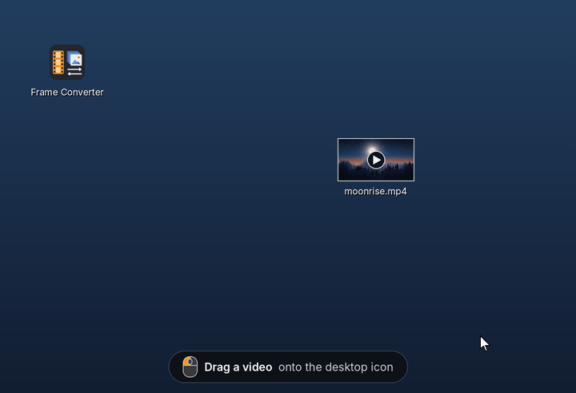

# FRAME CONVERTER - video to PNG/EXR sequence, and sequence back to a review movie

> **Note:** This repository serves as a visual and technical showcase of a custom desktop utility. Source code and binaries are kept private.




## SETUP (once)
1. Unzip this folder somewhere permanent, e.g. `C:\Tools\FrameConverter` (keep all the files together: the two `.cube` files are needed for EXR).
2. Double-click `Install_Desktop_Icon.bat`. A "Frame Converter" icon appears on your Desktop. If you move the folder later, just run it again.
3. Needs ffmpeg. If the window says "ffmpeg was not found", open Command Prompt and run:
   ```cmd
   winget install Gyan.FFmpeg
   ```
   then close and reopen the window (sign out and back in if it still can't find it).

## USE
Drag and drop onto the desktop icon:

| Input | Action |
| :--- | :--- |
| **A VIDEO** | asks: `P` = PNG sequence or `E` = EXR sequence (press P or E, no Enter needed) |
| **A SEQUENCE FOLDER** | makes a review movie |
| **ANY FRAME of a sequence** | same as dropping its folder |

You can drop several items at once, videos and sequences mixed. All the videos in one drop use the same PNG/EXR choice. When it says "All done.", press any key to close the window.

## WHAT YOU GET (always saved next to what you dropped)

| Input | Output |
| :--- | :--- |
| `myshot.mp4` + `P` | `myshot_png\myshot_1001.png`, `myshot_1002.png` ... |
| `myshot.mp4` + `E` | `myshot_exr\myshot_1001.exr`, `myshot_1002.exr` ... |
| `myshot_png` (folder) | `myshot_review.mov` (the `_png` / `_exr` ending is dropped from the movie name) |

| Format | Details |
| :--- | :--- |
| **PNG** | display colours, as the video looks in a player. |
| **EXR** | 16-bit half float, ZIP1 compression, scene-linear. In Nuke, read these as linear. |
| **Movie** | H.264, 24 fps, near-lossless (CRF 18), tagged Rec.709, plays everywhere. EXR sequences are converted back to display colours first. |

* **Videos:** `mp4` `mov` `m4v` `mkv` `avi` `webm` `mxf` `mts` `wmv` `mpg` `mpeg`
* **Frames:** `png` `exr` `jpg` `jpeg` `tif` `tiff`

## SETTINGS (open FrameConverter.bat in Notepad, top of the file)

| Setting | Description |
| :--- | :--- |
| `START=1001` | first frame number of new sequences (VFX convention) |
| `FPS=24` | frame rate of review movies |
| `CRF=18` | movie quality: lower = better and bigger |
| `MOVIE_EXT=mov` | mov or mp4 |
| `EXR_CURVE=rec709` | how EXR frames are linearized:<br>`rec709` = like Nuke's "rec709" colorspace (default)<br>`bt1886` = like ACES "Output - Rec.709" (gamma 2.4)<br>`none` = keep display values (then set the Read to rec709 in Nuke) |
| `EXR_TYPE=half` | half or float |

## NOTES
* Sequences need 4-digit frame numbers at the end of the name (`name_1001.png`) and no gaps: the movie stops at the first missing frame.
* If a folder holds several file types, PNG is used first, then EXR, JPG, TIF.
* Review movies: EXR values above 1.0 are clipped (it's a preview, not a master). Odd image sizes are trimmed by one pixel, since H.264 needs even sizes.
* Audio is not kept.
* Running it again overwrites the files from last time without asking.
